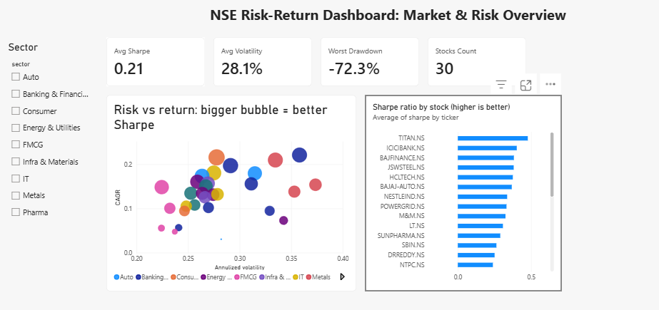
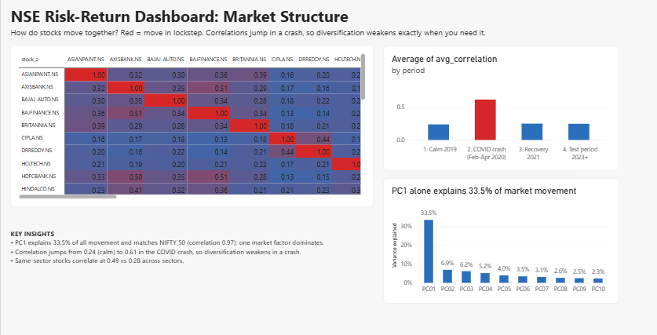
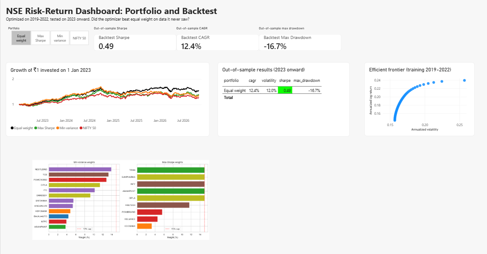

# NSE Risk-Return Profiler & Portfolio Optimizer

An end-to-end analytics project on 30 NSE large-cap stocks (2018-2026): risk profiling, hidden-factor analysis (PCA), portfolio optimization, and an honest out-of-sample backtest, delivered with a 3-page Power BI dashboard.

## Key findings

| Question | Finding |
|---|---|
| Are returns normal? | No. All 30 stocks (and NIFTY 50) reject normality; excess kurtosis ranges from 3.2 to 34.5 (AXISBANK). Extreme days are far more common than a bell curve predicts. |
| How much is "the market"? | PC1 explains 33.5% of total movement and correlates 0.97 with NIFTY 50, so PCA recovers the market factor on its own. |
| Does diversification hold in a crash? | Average pairwise correlation rises from 0.24 (calm 2019) to 0.61 (COVID crash), then falls back to about 0.25. |
| Sector structure | Same-sector correlation is 0.49 vs 0.28 across sectors. |
| Do optimizers beat equal weight? | **No, out of sample.** Equal-weight Sharpe is 0.49 vs 0.22 (max Sharpe) and 0.17 (min variance). Max Sharpe fell from 0.86 in training to 0.22 in testing, a sign of overfitting to past winners. |

## Dashboard





## Method

1. **Data:** daily split- and dividend-adjusted prices from Yahoo Finance via `yfinance`; validated, gap-limited forward fill, aligned to common trading days.
2. **Returns and distribution:** log returns, skewness, excess kurtosis, Jarque-Bera test, Q-Q plots.
3. **Risk:** Sharpe, Sortino, max drawdown, historical VaR/CVaR (95%), covariance and correlation matrices.
4. **PCA:** on standardized returns to find latent factors.
5. **Optimization:** min-variance and max-Sharpe with a long-only constraint and 15% weight cap (SciPy SLSQP); efficient frontier; hand-written projected steepest descent that reproduces the min-variance solution (volatility 0.1569).
6. **Backtest:** weights fitted on 2019-2022, held on 2023 onward against equal weight and NIFTY 50.

## Project structure

```
src/        config, data loading, metrics, PCA, optimization, backtest
notebooks/  01 returns, 02 risk & correlation, 03 PCA, 04 optimization, 05 backtest & stress
outputs/    figures and the CSVs feeding Power BI
powerbi/    NSE_Risk_Return_Dashboard.pbix
docs/       dashboard screenshots
```

## Run it

```powershell
python -m venv .venv
.venv\Scripts\Activate.ps1
pip install -r requirements.txt
python -m src.data_loader
```

Then run notebooks 01 to 05 in order. To open the dashboard, repoint the CSV data source in Power BI (**Home > Transform data > Data source settings**) to your local `outputs\powerbi` folder.

## Assumptions and limitations

- **Survivorship bias:** the universe is today's large-caps, which inflates returns versus NIFTY 50.
- **Short test window:** about 3.8 years, a single market regime.
- Portfolios are rebalanced daily to constant weights; transaction costs are ignored.
- Risk-free rate is fixed at 6.5% (approximate Indian 10Y G-Sec yield).
- The NIFTY Sharpe threshold (0.17) in the dashboard measure and the weights image on Page 3 are static.

## Future work

Shrinkage covariance (Ledoit-Wolf), rolling re-optimization, return forecasting models, regime detection (HMM/GMM), and ML-based allocation.